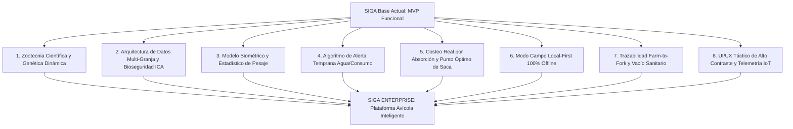
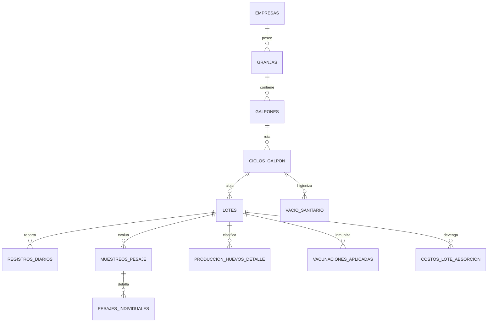
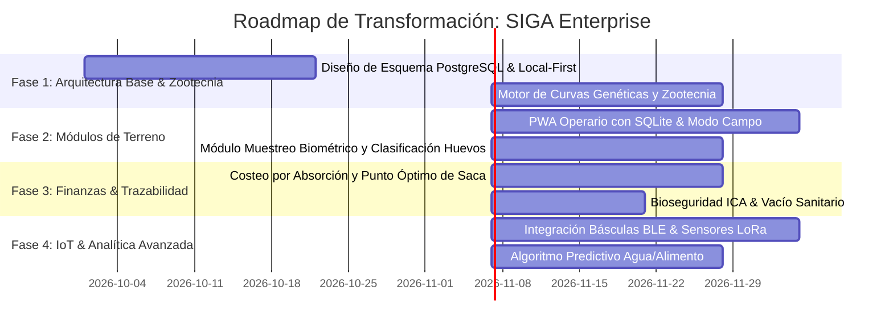

# SIGA Enterprise: Propuesta Maestra de Evolución y Mejora Integral
**Sistema Integrado de Gestión Avícola de Nueva Generación**

---

## 1. Diagnóstico Ejecutivo y Visión Estratégica

El proyecto **SIGA** actual cuenta con una base sólida conceptual en sus cuatro documentos fundacionales:
1. *Levantamiento de Requisitos (Visión inicial v1.0)*
2. *Análisis y Especificación Detallada de Requisitos (RF, RNF, Casos de Prueba, KPIs)*
3. *Esquema Relacional de Base de Datos (MySQL DDL, vistas, stored procedures)*
4. *Manual de Identidad Corporativa (Paleta de color, tipografía Inter, componentes UI)*

Sin embargo, para convertir a **SIGA** en una solución de clase mundial que compita y supere a líderes del sector (como MTech Systems, Agritec Soft, PoultryHub o Fancom/Chore-Time Cloud), identificamos **8 brechas críticas** y proponemos **saltos cualitativos directos**:



---

## 2. Elevación Zootécnica y de Ingeniería Avícola

### 2.1 Tablas Genéticas Dinámicas y Multi-Estirpe Interpoladas
*Problema en el diseño previo:* Se asumían metas fijas generales (p. ej., "Conversión a 42 días < 1.55"), ignorando que cada línea genética y cada sub-línea tiene tablas técnicas específicas por día y por sexo.
*Mejora:*
* **Cátálogo Genético Oficial Parametrizado:**
  * **Engorde:** Ross 308 AP / Ross 708, Cobb 500 Slow / Fast Feathering, Hubbard Efficiency Plus, Arbor Acres Plus.
  * **Ponedoras:** Lohmann Brown-Classic / Lite, Hy-Line Brown / W-36, ISA Brown, Novogen Brown.
* **Curvas Diarias Interpoladas:** Peso objetivo diario ($g$), Ganancia Diaria ($GDP$), Consumo Diario ($g/ave$), Consumo Acumulado ($g/ave$) y Conversión Alimenticia esperada ($CA$), diferenciadas por:
  * Lote mixto (as-hatched).
  * Lote sólo machos (sexado).
  * Lote sólo hembras (sexado).
* **Cálculo de Desviación Zootécnica ($Z\text{-Score}$):** En lugar de solo avisar si está por debajo del estándar, calcular la desviación estándar respecto a la curva de la casa genética para anticipar desnutrición o engrasamiento excesivo.

### 2.2 Biometría y Distribución Estadística en Pesajes
*Problema en el diseño previo:* `registros_diarios` tenía campos planos `peso_promedio` y `aves_pesadas`, perdiendo la distribución de frecuencias.
*Mejora:*
* Muestreo biométrico de mínimo 100 aves o 1% del galpón, calculando en tiempo real:
  $$\text{Media } (\mu) = \frac{\sum x_i}{n}$$
  $$\text{Desviación Estándar } (\sigma) = \sqrt{\frac{\sum (x_i - \mu)^2}{n-1}}$$
  $$\text{Coeficiente de Variación } (CV\%) = \left(\frac{\sigma}{\mu}\right) \times 100$$
  $$\text{Uniformidad } (\%U) = \frac{\text{Aves entre } 0.90\mu \text{ y } 1.10\mu}{n} \times 100$$
* **Alertas zootécnicas de lote dispar:** Si el $CV > 10\%$ o la Uniformidad $< 80\%$, el sistema sugiere calibración de comederos, división del galpón (grading/clasificación por corraletas) o ajuste de presiones de bebederos.

### 2.3 El Indicador Predictivo Supremo: Razón Agua/Alimento
*Aporte Científico:* Las aves enfermas, estresadas térmicamente o con problemas entéricos **dejan de beber o de comer entre 24 y 48 horas antes de que comience el pico de mortalidad**.
*Mejora:*
* Medición diaria/horaria del consumo de agua (litros mediante caudalímetro de pulsos o registro de reloj de agua).
* Ratio hídrico:
  $$\text{Relación Agua/Alimento} = \frac{\text{Litros de Agua consumidos}}{\text{kg de Alimento consumido}}$$
  * *Rango normal a 21°C:* $1.60 - 1.85$ L/kg.
  * *Estrés calórico:* $\ge 2.20$ L/kg (consume agua para disipar calor, jadeo).
  * *Problema de potabilidad / Cloro / Bloqueo de línea:* $< 1.40$ L/kg (alerta crítica inmediata).

### 2.4 Control Ambiental: Índice de Entalpía y Confort Térmico
*Problema:* Solo registrar Temp Mín/Máx y Humedad es insuficiente en galpones modernos (túnel o ambiente cerrado).
*Mejora:*
* Cálculo automático de la **Entalpía del Aire ($h$)** o Índice de Temperatura y Humedad ($ITH$):
  $$h = 1.006 \cdot T + W \cdot (2501 + 1.86 \cdot T) \quad [\text{kJ/kg de aire seco}]$$
  Donde $W$ es la humedad específica.
* Evaluación de velocidad del aire ($m/s$) para determinar la **Sensación Térmica Real del ave (Wind-Chill Effect)**.

### 2.5 Clasificación Normativa del Huevo (NTC 1240 / USDA) y Métricas de Frescura
*Mejora:*
* Tipificación comercial estricta:
  * **Jumbo:** $> 78\text{ g}$
  * **AAA:** $67.0 - 77.9\text{ g}$
  * **AA:** $60.0 - 66.9\text{ g}$
  * **A:** $53.0 - 59.9\text{ g}$
  * **B:** $46.0 - 52.9\text{ g}$
  * **C:** $< 46.0\text{ g}$
* **Huevos no conformes:** Fisurados en nidal, rotos en recolección, sucios de heces, deformes, fárfara (sin cáscara / deficiencia de calcio), microfisuras (ovoscopía UV).
* **Calidad Interna:** Registro opcional de **Unidades Haugh ($HU$)** y Coloración de Yema (Escala DSM / Roche 1-15):
  $$HU = 100 \cdot \log_{10} (H - 1.7 \cdot W^{0.37} + 7.6)$$
  Donde $H$ es la altura del albumen denso (mm) y $W$ es el peso del huevo (g).

---

## 3. Rediseño y Expansión del Modelo de Datos (PostgreSQL Enterprise)

El esquema previo era monolítico y plano en una sola entidad de granja. Se introduce la **jerarquía territorial real**, trazabilidad de bioseguridad según regulaciones del ICA (Resoluciones 3651 y 3652 para Granjas Avícolas Bioseguras), módulo de muestreos y costeo analítico.



### 3.1 DDL Mejorado (Extracto Clave)

```sql
-- Jerarquía territorial y de bioseguridad ICA
CREATE TABLE empresas (
    id UUID PRIMARY KEY DEFAULT gen_random_uuid(),
    razon_social VARCHAR(150) NOT NULL,
    nit VARCHAR(20) UNIQUE NOT NULL,
    registro_ica_nacional VARCHAR(50),
    created_at TIMESTAMPTZ DEFAULT NOW()
);

CREATE TABLE granjas (
    id UUID PRIMARY KEY DEFAULT gen_random_uuid(),
    empresa_id UUID NOT NULL REFERENCES empresas(id) ON DELETE CASCADE,
    codigo VARCHAR(20) NOT NULL,
    nombre VARCHAR(100) NOT NULL,
    registro_ica_gab VARCHAR(50) NOT NULL, -- Granja Avícola Biosegura
    latitud NUMERIC(10, 7),
    longitud NUMERIC(10, 7),
    altitud_msnm INT,
    tipo_produccion VARCHAR(30) CHECK (tipo_produccion IN ('engorde', 'postura_comercial', 'reproductoras', 'mixta')),
    temperatura_promedio_historica NUMERIC(4, 1),
    created_at TIMESTAMPTZ DEFAULT NOW()
);

CREATE TABLE galpones (
    id UUID PRIMARY KEY DEFAULT gen_random_uuid(),
    granja_id UUID NOT NULL REFERENCES granjas(id) ON DELETE CASCADE,
    codigo VARCHAR(20) NOT NULL,
    tipo_tecnologia VARCHAR(40) CHECK (tipo_tecnologia IN ('ambiente_natural_cortinas', 'tunel_presion_negativa', 'dark_house_combi')),
    longitud_metros NUMERIC(6, 2) NOT NULL,
    ancho_metros NUMERIC(6, 2) NOT NULL,
    area_util_m2 NUMERIC(8, 2) GENERATED ALWAYS AS (longitud_metros * ancho_metros) STORED,
    tipo_comederos VARCHAR(50), -- 'plato_automatico', 'lineal_cadena', 'tolva_manual'
    tipo_bebederos VARCHAR(50), -- 'niple_con_recogedor', 'campana', 'canaleta'
    densidad_maxima_aves_m2 NUMERIC(4, 1) DEFAULT 14.0,
    capacidad_diseno_aves INT NOT NULL,
    estado VARCHAR(20) DEFAULT 'disponible' CHECK (estado IN ('disponible', 'ocupado', 'vacio_sanitario', 'mantenimiento')),
    UNIQUE(granja_id, codigo)
);

-- Módulo crítico: VACÍO SANITARIO Y BIOSEGURIDAD
CREATE TABLE vacios_sanitarios (
    id UUID PRIMARY KEY DEFAULT gen_random_uuid(),
    galpon_id UUID NOT NULL REFERENCES galpones(id),
    fecha_inicio DATE NOT NULL,
    fecha_fin_proyectada DATE NOT NULL,
    fecha_fin_real DATE,
    retiro_pollinaza_completado BOOLEAN DEFAULT FALSE,
    lavado_espumogeno_completado BOOLEAN DEFAULT FALSE,
    flameo_piso_completado BOOLEAN DEFAULT FALSE,
    desinfeccion_quimica_completado BOOLEAN DEFAULT FALSE,
    analisis_hisopado_salmonella VARCHAR(20) CHECK (analisis_hisopado_salmonella IN ('pendiente', 'negativo', 'positivo')),
    analisis_hisopado_enterobacterias VARCHAR(20) CHECK (analisis_hisopado_enterobacterias IN ('conforme', 'no_conforme')),
    dias_descanso_sanitario INT GENERATED ALWAYS AS (COALESCE(fecha_fin_real, CURRENT_DATE) - fecha_inicio) STORED,
    aprobado_por_veterinario UUID REFERENCES usuarios(id),
    estado VARCHAR(20) DEFAULT 'en_proceso' CHECK (estado IN ('en_proceso', 'certificado_apto', 'rechazado'))
);

-- Pesajes con distribución estadística completa
CREATE TABLE muestreos_pesaje (
    id UUID PRIMARY KEY DEFAULT gen_random_uuid(),
    lote_id UUID NOT NULL REFERENCES lotes(id) ON DELETE CASCADE,
    fecha DATE NOT NULL,
    edad_dias INT NOT NULL,
    hora TIME DEFAULT CURRENT_TIME,
    numero_aves_muestreadas INT NOT NULL CHECK (numero_aves_muestreadas >= 30),
    peso_promedio_g NUMERIC(7, 2) NOT NULL,
    desviacion_estandar_g NUMERIC(6, 2) NOT NULL,
    coeficiente_variacion_pct NUMERIC(5, 2) NOT NULL,
    porcentaje_uniformidad_pct NUMERIC(5, 2) NOT NULL,
    peso_meta_genetica_g NUMERIC(7, 2),
    diferencia_vs_meta_g NUMERIC(7, 2),
    metodo_pesaje VARCHAR(30) CHECK (metodo_pesaje IN ('manual_dinamometro', 'bascula_electronica_automatica', 'muestreo_atrapado_percha')),
    registrado_por UUID REFERENCES usuarios(id),
    created_at TIMESTAMPTZ DEFAULT NOW()
);

-- Farmacovigilancia y Periodos de Retiro Farmacológico (Lockout System)
CREATE TABLE tratamientos_sanitarios (
    id UUID PRIMARY KEY DEFAULT gen_random_uuid(),
    lote_id UUID NOT NULL REFERENCES lotes(id),
    medicamento_id UUID NOT NULL REFERENCES inventario_insumos(id),
    principio_activo VARCHAR(100) NOT NULL,
    dosis_mg_kg NUMERIC(8, 2) NOT NULL,
    via_administracion VARCHAR(30) CHECK (via_administracion IN ('agua_bebida', 'alimento_mezcla', 'inyeccion_subcutanea', 'aspersión')),
    fecha_inicio DATE NOT NULL,
    fecha_fin DATE NOT NULL,
    dias_periodo_retiro INT NOT NULL,
    fecha_liberacion_sacrificio DATE GENERATED ALWAYS AS (fecha_fin + (dias_periodo_retiro || ' days')::INTERVAL) STORED,
    bloqueo_sacrificio_activo BOOLEAN DEFAULT TRUE,
    prescrito_por_veterinario VARCHAR(100) NOT NULL,
    numero_tarjeta_profesional VARCHAR(50) NOT NULL
);
```

---

## 4. Arquitectura de Software "Local-First" para el Campo

Las granjas avícolas sufren de zonas muertas de señal celular y estructuras metálicas que bloquean la radiofrecuencia (jaula de Faraday). Proponer una arquitectura puramente "Online con JWT de 15 minutos" condena al operario al fracaso.

### 4.1 Arquitectura Local-First y Offline-Resilient

```
┌───────────────────────────────────────────────────────────────┐
│                 PWA Operario / Tablet de Galpón               │
│                                                               │
│   ┌───────────────────────────────────────────────────────┐   │
│   │ UI Táctil Alto Contraste (Modo Campo Guante / Sol)    │   │
│   └───────────────────────────┬───────────────────────────┘   │
│                               │                               │
│   ┌───────────────────────────▼───────────────────────────┐   │
│   │ Local Store: SQLite (WASM/OPFS) / RxDB IndexedDB     │   │
│   │  - Validación inmediata de rangos (Reglas Zootécnicas) │   │
│   │  - Colas de Mutación Transaccional Offline            │   │
│   └───────────────────────────┬───────────────────────────┘   │
│                               │ Web Bluetooth / NFC           │
│   ┌───────────────────────────▼───────────────────────────┐   │
│   │ Sensores & Básculas: BLE GATT / Caudalímetros LoRa    │   │
│   └───────────────────────────────────────────────────────┘   │
└───────────────────────────────┬───────────────────────────────┘
                                │ Sync Engine (WebSocket/CRDT)
                                │ Auto-detect Network + Backoff
┌───────────────────────────────▼───────────────────────────────┐
│                  Servidor Cloud / Edge Central                │
│                                                               │
│   ┌───────────────────────────────────────────────────────┐   │
│   │ API Gateway + Conflict Resolution Engine              │   │
│   │  - Deterministic Vector Clocks                        │   │
│   │  - Auditoría Append-Only                              │   │
│   └───────────────────────────┬───────────────────────────┘   │
│                               │                               │
│   ┌───────────────────────────▼───────────────────────────┐   │
│   │ PostgreSQL TimescaleDB (Métricas IoT & Series Temp.)  │   │
│   │ Redis Pub/Sub (Alertas Críticas SMS/WhatsApp/Push)    │   │
│   └───────────────────────────────────────────────────────┘   │
└───────────────────────────────────────────────────────────────┘
```

* **Persistencia Cero Latencia:** El operario presiona "Guardar" y la transacción se sella en $< 5\text{ ms}$ en la base de datos local embebida (SQLite WASM con persistencia Origin-Private File System o RxDB).
* **Resolución de Conflictos Zootécnicos:** No usar "el último que escribe gana". Las métricas diarias se resuelven mediante **Event Sourcing / Log Aditivo** con sellado criptográfico del dispositivo y del operario.
* **Integración Web Bluetooth (BLE):** Captura directa de pesos desde balanzas digitales de gancho (Chore-Time / Dibal / Systel) eliminando la anotación en papel y posterior transcripción errónea.

---

## 5. Algoritmos Predictivos y Zootecnia Computacional

### 5.1 Estimador de Saca Óptima Económica (Engorde)
En pollos de engorde, conforme aumentan los días de vida, la ganancia de peso marginal decrece mientras que la conversión alimenticia empeora rápidamente (se requieren más kg de alimento por cada gramo de músculo adicional).

$$\text{Margen}(\text{día } t) = \text{Precio Venta}(t) \cdot \text{Peso Promedio}(t) - \left[ \text{Costo Pollito} + \sum_{i=1}^t \text{Consumo}_i \cdot \text{Costo Alimento}_i + \text{Costos Fijos Diarios} \cdot t \right]$$

El sistema calcula la derivada del margen respecto al tiempo:
$$\frac{d(\text{Margen})}{dt} = 0$$
Y alerta con 7 días de antelación el **rango exacto de días (ej. Día 39 a 41)** donde el lote alcanza el beneficio económico máximo por metro cuadrado antes de caer en pérdidas por sobreconsumo.

### 5.2 Curva de Persistencia en Ponedoras y Estimación de Descarte / Muda
* Proyección de postura acumulada modelada mediante ecuaciones de curvas de Adams-Bell o Gompertz modificada.
* **Punto de Quiebre de Reemplazo:** Compara el costo de mantener a la ponedora (consumo diario de 115g de alimento a valor de mercado) versus los ingresos generados por los huevos puestos según su clasificación por calibre.
* Cuando el margen neto semanal por ave es menor al costo amortizado de crianza de una pollona de reemplazo (semana 16-18), emite la recomendación de **venta de gallina descarte o pelecha/muda inducida**.

---

## 6. Costeo Analítico por Absorción (Lote Unitario)

La base de datos original tenía una tabla simple `costos`. Las operaciones avícolas profesionales exigen costeo por absorción que distribuya los gastos reales:

| Centro de Costos | Método de Asignación | Fórmula |
| :--- | :--- | :--- |
| **Pollito BB de 1 día** | Directo | $\text{Cantidad Inicial} \times \text{Precio Unitario}$ |
| **Nutrición por Fases** | Directo ponderado | $\sum (\text{Bolsas o Toneladas consumidas} \times \text{Precio Lote Fábrica})$ |
| **Bioseguridad y Vacunas** | Directo | Costo de biológicos + agujas/dosificadores por ave tratada |
| **Material de Cama** | Directo | Camiones de cascarilla de arroz/viruta aplicados por ciclo |
| **Energía y Calefacción** | Medición/Estimado | Litros de Gas Propano (criadoras) + kWh de turbinas de ventilación |
| **Mano de Obra de Galpón** | Directo | Días-hombre asignados al lote |
| **Vacío Sanitario Previo** | Amortizado | Costo total del descanso y desinfección cargado al siguiente lote |
| **Costos Indirectos Granja** | Porcentaje prorrateado | (Supervisión veterinaria, predial, seguridad, mantenimiento) por $m^2$ ocupado |

Con esto, el sistema reporta automáticamente:
* **Costo por Kilogramo Vivo Producido:** $\$ / \text{kg}$
* **Costo por Ave en Pie:** $\$ / \text{ave}$
* **Costo por Huevo Clasificado Comercial:** $\$ / \text{huevo}$ o $\$ / \text{docena / cubeta (30 huevos)}$

---

## 7. Elevación del Sistema de Diseño UI/UX

### 7.1 Filosofía de Diseño: "High-Contrast Agricultural Command Center"
En los galpones, el operario enfrenta:
1. Resplandor solar directo al aire libre ($>10,000\text{ lux}$).
2. Penumbra o luces tenues (5 a 10 lux en galpones *dark-house* para calmar a las aves).
3. Manos con guantes de nitrilo, polvo de cascarilla o suciedad.

* **Modo Campo de Ultra-Contraste:**
  * Fuentes numéricas monoespaciadas de gran escala (`font-variant-numeric: tabular-nums`).
  * Teclado táctil virtual numérico (*numpad*) gigante embebido con retroalimentación háptica (vibración).
  * Comandos de voz ("*Mortalidad 6 respiratoria galpón 2*") procesados mediante Web Speech API local.
* **Dashboard Ejecutivo "Command Center":**
  * Fondo obscuro sofisticado estilo Grafana/Bloomberg agtech (`#0F172A`).
  * Paleta corporativa optimizada: Verde Follaje Profundo (`#22C55E`), Tierra Cacao (`#854D0E`), Ámbar Maíz (`#EAB308`), Rojo Alerta Bio (`#EF4444`).
  * Microinteracciones en tiempo real con WebSockets para semáforos de mortalidad y fallos de energía en túneles de ventilación.

---

## 8. Hoja de Ruta de Implementación de Alto Nivel


